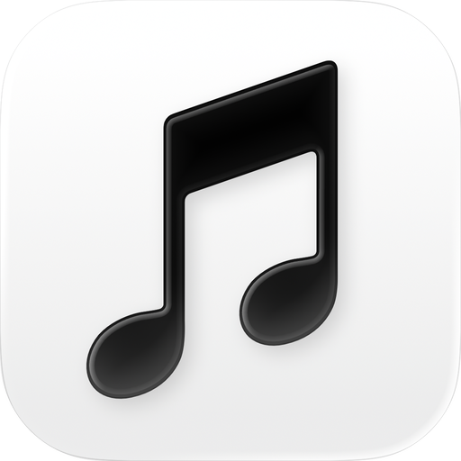

# **Apple Music Discord Rich Presence**

## **Contents**
1. Project Overview
2. App Features
3. App Installation
4. Running From Source
5. Making a Release

## **Project Overview**

This app bridges [Discord](https://discord.com) and [Apple Music](https://www.apple.com/apple-music/). Apple's Music app on macOS, the Apple Music app and iTunes on Windows, and Apple Music on Linux don't support [Discord Rich Presence](https://discord.com/rich-presence) out of the box, so this app adds it. Spotify has had full Discord integration for years, so it's about time Apple Music got something efficient too.

### **Project Goals:**
* Accurate song timing that stays in sync when you skip or seek
* Use as little CPU as possible, so your computer doesn't lag and your fans stay quiet

## **App Features**

### **1. "Listening to Apple Music"**
  * Shows as **Listening to Apple Music** on your profile, just like Spotify
  * Song name, artist and album
  * A progress bar with elapsed and total time (you can turn it off)

### **2. Album Artwork**
  * Shows the song's real album cover
  * Looked up once per song with Apple's public iTunes Search API. You can turn this off from the menu.
  * Without artwork, it shows Apple's current Apple Music logo, fetched live from the App Store so it stays up to date when Apple redesigns it
  * **Animated covers**: popular albums with a moving cover in Apple Music show it on Discord too. They come from [Animated Album Covers](https://github.com/rustybusgaming/apple-music-animated-covers), which converts the covers of the most-played albums every day. You can turn this off from the menu.

### **3. Paused Status**
  * Shows that the song is paused, with no timer running

### **4. Menu Bar / Tray Icon**
  * See what's playing and whether Discord is connected
  * Turn the status, progress bar, artwork or animated covers on and off
  * Open the app automatically at login
  * See which version you have and **Check for Updates**, or let it update itself
  * Quit the app

### **Good to know**
  * Works with the **Music** app on macOS, with the **Apple Music** app (from the Microsoft Store) or **iTunes** on Windows, and on Linux with Apple Music players such as [Cider](https://cider.sh) or, if you turn it on, Apple Music in a web browser.
  * Your status updates the moment a song changes, plays or pauses, and the app uses almost no CPU in between.
  * **Updates install themselves**: once a day the app checks GitHub for a new version. When there is one, it downloads it, checks it isn't damaged, swaps it in and starts again, then tells you it's updated. Turn off **Install Updates Automatically** in the menu to choose when: an **Install Update** item then appears at the top of the menu instead. If the app can't update itself (say, it's in a folder you can't change), the item opens the download page.
  * Starting it before Discord is fine. It connects once Discord opens and reconnects if Discord restarts.
  * It never opens Music, Apple Music or iTunes by itself. Quitting the player clears your status.
  * Internet radio streams show the song that's playing, not just the station name.

## **App Installation**

Download the latest version from [releases](https://github.com/rustybusgaming/Apple-Music-Rich-Presence/releases/latest). Under "Assets", pick the file for your computer:

| Computer | File |
| --- | --- |
| Mac (Intel or Apple Silicon) | `AppleMusicRPC-Mac.zip` |
| Windows PC (64-bit) | `AppleMusicRPC-Windows-64bit.zip` |
| Windows on ARM (e.g. Snapdragon laptops) | `AppleMusicRPC-Windows-ARM.zip` |
| Linux PC (64-bit) | `AppleMusicRPC-Linux-64bit.zip` |
| Linux on ARM (e.g. Raspberry Pi 4/5 with a 64-bit OS) | `AppleMusicRPC-Linux-ARM.zip` |

* ###  macOS 12+

  1. Open the zip from your **Downloads** folder and drag **AppleMusicRPC** into your **Applications** folder.

  2. Open the app. The app isn't notarized by Apple, so macOS warns that it can't verify it. Click **Done**, then go to **System Settings → Privacy & Security**, scroll down and click **Open Anyway**. You only need to do this once.

  3. When macOS asks whether AppleMusicRPC can control Music, click **OK**. The app's icon then appears in your menu bar.

  Keep the app in **Applications**: it can't update itself while it runs from **Downloads**. After an update, macOS may ask again whether it can control Music, since the app isn't signed with an Apple developer certificate; click **OK** again.

* ### Windows 10 / 11

  1. Unzip the file and open the **AppleMusicRPC** folder inside.

  2. Run **AppleMusicRPC.exe**. If Windows SmartScreen warns about an unrecognized app, click **More info → Run anyway**.

  3. The app appears in the system tray (you may need to click the **^** arrow to see it), and your status shows up once Apple Music or iTunes is playing.

* ### Linux

  Apple doesn't make Apple Music for Linux, so the app reads what's playing from Linux's standard media controls (MPRIS). That works with Apple Music players like **Cider**, and with **music.apple.com in a web browser**.

  1. Unzip the file, open the **AppleMusicRPC** folder and run **AppleMusicRPC**.

  2. The app appears in your system tray. On GNOME, this needs the AppIndicator extension, which Ubuntu includes.

  3. **Listening in a web browser?** Turn on **Include Web Browsers** in the app's menu. Browsers report every site the same way, so the app can't tell Apple Music apart from, say, YouTube; with this on, whatever the browser is playing shows as Apple Music.

  4. **Using Cider?** Turn off Cider's own Discord status, or your profile will show both.

  The app finds Discord whether it's installed normally, as a Flatpak or as a Snap. If Discord itself runs in a web browser, there's nothing for the app to talk to.

* ### FreeBSD

  There's no FreeBSD download: Electron, which the app is built on, doesn't support FreeBSD officially, and there's no Discord app for FreeBSD for the status to go to. If you have FreeBSD's community Electron and a Discord client that supports Rich Presence, you can run the app from source (see below); it works the same way as on Linux.

* ### Troubleshooting

  * **"Not allowed to read Music"**: macOS is blocking the app from reading Music. Click **Allow Access to Music…** in the app's menu, then turn on **Music** under **AppleMusicRPC**. If you started the app with `npm start`, turn it on for the app you ran that from (e.g. Terminal) instead.
  * **"Music isn't open" even though it is**: you have an older version that showed this message for the permission problem above. Update to the latest version.
  * **"Couldn't read Music: …"**, **"Couldn't read Apple Music: …"** or **"Couldn't read iTunes: …"**: something else went wrong. Click **Copy Error Details** in the app's menu and include that text when you open an issue.

## **Running From Source**

You'll need [Node.js](https://nodejs.org) 22.12 or newer.

```bash
npm install
npm start        # run the app (on Linux, if it won't start: npm start -- --no-sandbox)
npm test         # run the tests
npm run build    # package for Windows and Linux (x64 and arm64) and macOS (universal) into dist/
```

To refresh the icons with Apple's latest Apple Music logo (needs Python and Pillow):

```bash
python scripts/update_logo.py
```

## **Making a Release**

A GitHub Action (`.github/workflows/release.yml`) builds the app for macOS, Windows and Linux on every push. It downloads Apple's latest Apple Music logo first, so every build uses the current icon. To publish a release:

1. Optionally, write the release notes in `release-notes/v1.2.0.md` and commit them. Without that file, GitHub writes notes from the commit history.
2. Go to the repository's **Actions** tab → **Build and release** → **Run workflow**.
3. Enter a version number like `1.2.0` and click **Run workflow**.

The action creates the `v1.2.0` tag and a release with the notes and the five zips attached. Pushing a tag like `v1.2.0` does the same. Running it again for an existing version updates that release.
